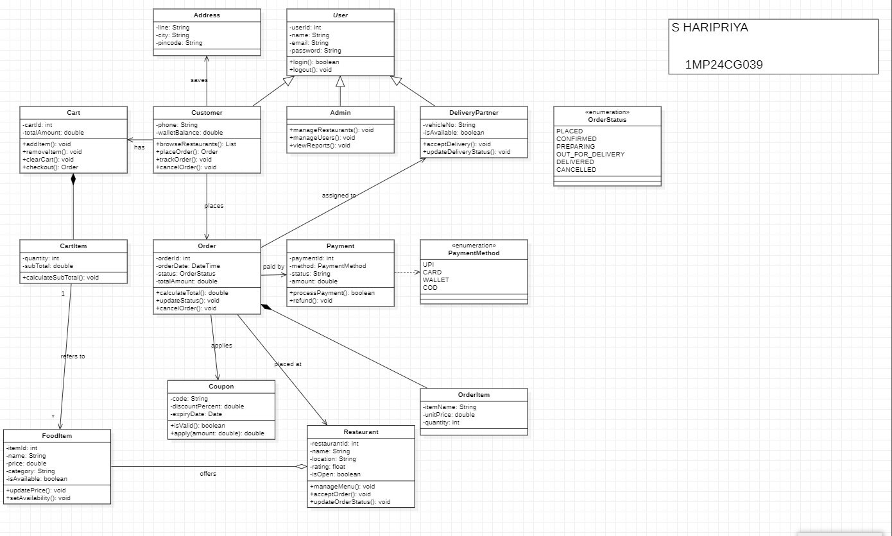

# OOD
# Online Food Ordering System

An object-oriented design (OOD) project: a simple online food ordering website built with **Python + Flask**, designed from a **UML class diagram** (StarUML).

Customers can browse restaurants, add food to a cart, apply a coupon, pay using multiple methods, and track their order until delivery. Restaurants and delivery partners move the order through its lifecycle.

---

## Features

- Browse restaurants and menus
- Cart with add / remove items (one restaurant per cart)
- Coupon support (try `SAVE10` for 10% off)
- Payment methods: **UPI, Card, Wallet, Cash on Delivery**
- Order tracking: `PLACED -> CONFIRMED -> PREPARING -> OUT_FOR_DELIVERY -> DELIVERED` (or `CANCELLED`)
- Cancel an order before preparation starts (wallet payments are refunded)
- Restaurant / delivery panel to advance order status
- Admin report (total orders, delivered orders, revenue)

---

## Project Structure

```
.
├── app.py                              # Flask website (routes + templates)
├── food_ordering.py                    # Core OOP classes (the UML implemented)
├── patterns_demo.py                    # Strategy + Observer pattern demo
├── food_ordering_uml_v2.png            # UML class diagram (image)
├── Online_Food_Ordering_System.mdj     # UML class diagram (open in StarUML)
└── README.md
```

---

## UML Class Diagram



The `.mdj` file can be opened directly in [StarUML](https://staruml.io) (File -> Open).

### Classes (15)

| Group | Classes |
|---|---|
| Users | `User` (abstract), `Customer`, `Admin`, `DeliveryPartner` |
| Restaurant | `Restaurant`, `FoodItem` |
| Shopping | `Cart`, `CartItem` |
| Orders | `Order`, `OrderItem`, `Payment`, `Coupon`, `Address` |
| Enumerations | `OrderStatus`, `PaymentMethod` |

### Relationships

| Relationship | Type |
|---|---|
| `Customer`, `Admin`, `DeliveryPartner` -> `User` | Inheritance |
| `Cart` <>-- `CartItem` | Composition |
| `Order` <>-- `OrderItem` | Composition |
| `Restaurant` o-- `FoodItem` | Aggregation |
| `Customer` -> `Cart`, `Order`, `Address` | Association |
| `Order` -> `Restaurant`, `Payment`, `DeliveryPartner`, `Coupon` | Association |

---

## OOP Concepts Demonstrated

- **Abstraction:** `User` is an abstract class with an abstract `role()` method
- **Inheritance:** `Customer`, `Admin` and `DeliveryPartner` extend `User`
- **Encapsulation:** private attributes with public methods
- **Composition / Aggregation:** `Cart` owns its items; `Restaurant` has a menu
- **Enumerations:** fixed values for order status and payment method
- **Snapshot design:** `OrderItem` stores the price at order time, so later menu price changes do not alter past orders

### Design Patterns (`patterns_demo.py`)

- **Strategy:** interchangeable payment methods (`UPIPayment`, `CardPayment`, `WalletPayment`)
- **Observer:** `CustomerNotifier` and `RestaurantNotifier` are notified when an `Order` status changes

Run the demo with `python patterns_demo.py`.

---

## Getting Started

### Prerequisites

- Python 3.9+

### Installation and Run

```bash
# 1. Clone the repository
git clone https://github.com/<your-username>/<your-repo>.git
cd <your-repo>

# 2. Install Flask
pip install flask

# 3. Start the app
python app.py
```

## How to Use

1. **Menu:** pick items and click **Add**
2. **Cart:** optionally enter coupon `SAVE10`, choose a payment method, click **Place order**
3. **My orders:** view status and cancel while the order is still `PLACED` or `CONFIRMED`
4. **Restaurant/Delivery:** click **Next step** to move the order through confirmation, preparing, out for delivery and delivered
5. The admin report at the bottom of the panel shows totals and revenue

---

## Limitations

- Single demo customer (no login/registration page)
- Data is stored in memory and resets when the server restarts
- One restaurant per cart

## Future Improvements

- User login and registration
- Database storage (SQLite / PostgreSQL)
- Ratings and reviews
- Real-time order tracking
- Wire Strategy and Observer patterns into the main application

---

## Tech Stack

Python, Flask, StarUML

## Author

**[Haripriya]** - [BGS / CSD]
